# NetAdmin Desk

Настольное приложение системного администратора: клиент SSH, Telnet и консольного COM-порта с вкладками и разделением экрана для коммутаторов, Linux-серверов и серверов баз данных; офлайн-справочник команд для начинающих (коммутаторы, Linux, SQL — MySQL, MariaDB, PostgreSQL), выполнение команд из справочника с проверками, диагностика, поиск MAC, сценарии, резервные копии конфигураций, SFTP и SSH-туннели. Работает без интернета, телеметрии нет.

Версия: **1.0.0** (см. [CHANGELOG.md](CHANGELOG.md)).

## Что внутри

| Раздел | Возможности |
|---|---|
| Интерфейс | Простой режим по умолчанию: на виду только основные разделы, редкие — в «Ещё» внутри своей группы, группы «Инструменты» и «Справочник» сворачиваются (открытый раздел виден и в свёрнутой группе). Кнопка «Показать всё» включает полный режим. Любой раздел можно закрепить или убрать в «Ещё» правой кнопкой мыши или в «Настроить меню». Всё спрятанное доступно через Ctrl+K: разделы и действия («калькулятор», «разделить экран», «подключиться») |
| Сессии | **SSH, Telnet** (для старого оборудования, с предупреждениями) и **COM-порт / консольный кабель** (Web Serial, скорость 9600–115200). **Разделение экрана** на 2–4 сессии, **ввод во все** видимые панели с красной полосой-предупреждением, **окно команд** (несколько строк, подсказки из справочника, оценка риска, отправка в одну, все панели или все сессии), **подсветка вывода** (up/down, err-disabled, ненулевые ошибки, IP, MAC, интерфейсы), панель быстрых команд из избранного, быстрое подключение по адресу (`admin@10.0.0.1`, `telnet://…`, `COM3`), команды после входа, цвет метки устройства, Ctrl+колесо — шрифт. Вкладки и несколько сессий одновременно (меню вкладок как в браузере: закрыть другие / слева / справа / все, средняя кнопка — закрыть), «Проверка связи» (DNS → TCP-порт → приветствие SSH) с понятным объяснением ошибок, xterm.js, поиск в выводе, проверка ключа хоста с показом отпечатка SHA256 и блокировкой при его смене, устаревшие алгоритмы — только для отдельного устройства, Jump Host (ProxyJump), автоматический `enable`, отключение постраничного вывода, режим «Только чтение» |
| Справочник | Разделы «Коммутаторы», «Linux» и «Базы данных» — 1069 записей: 453 по коммутаторам (177 — из обезличенных TXT-заметок без изменения синтаксиса, 276 встроенных для 9 платформ), 406 команд Linux и 210 команд SQL (подключение, базы, таблицы, пользователи и права, резервные копии, мониторинг, блокировки, обслуживание, настройки, репликация, служба) с полными карточками; 274 простые команды для начинающих с подробными пояснениями (фильтр «Только простые команды»). В записях SQL отмечены отличия MySQL / MariaDB и PostgreSQL. В справочнике нет адресов, имён и названий конкретной организации — его можно передавать другим. Источник записи всегда виден: «Встроенный справочник», «Импортировано из файла», «Добавлено пользователем», «Проверено пользователем» |
| Выполнение из справочника | Выбор устройства, проверка совместимости платформы, шаблоны `{{INTERFACE}}`, `{{VLAN}}`, `{{MAC}}`…, показ итоговой команды, уровень риска, подтверждение изменяющих команд |
| Обучение | 56 руководств без интернета: первые шаги (в том числе консольный кабель, Telnet, работа с несколькими устройствами), основы сетей (IP, VLAN, trunk, STP, PoE, ошибки портов), задачи на коммутаторах разных производителей, Linux для начинающих, базы данных (вход, отличия синтаксиса MySQL / MariaDB / PostgreSQL, резервные копии, «не подключается», «тормозит», «кончается место», «не запускается», репликация), решение проблем, словарь терминов. Команды из руководств можно скопировать или выполнить с проверками |
| Поиск (Ctrl+K) | По командам, руководствам, устройствам, сценариям и заметкам. Понимает падежи и словоформы (стеммер русского языка), русское название программ («апач» → apache, «докер» → docker, «постгрес» → postgresql, «мускул» → mysql), запись по звучанию («курл» → curl), опечатки, вопросы обычными словами («как удалить папку»), неверную раскладку («ырщц мдфт» → `show vlan`) |
| Диагностика | Коммутаторы — 26 задач с профилями команд для каждой платформы; Linux — 40 проверок в 35 наборах (быстрая, «сервер тормозит», диски, безопасность, после сбоя…), из них 13 проверок баз данных: MySQL / MariaDB и PostgreSQL — служба и журнал, подключения и «Too many connections», долгие запросы и блокировки, место на диске (binlog, pg_wal), репликация и слоты, память и кодировка, VACUUM и счётчик транзакций. Только чтение, без sudo; критерии оценки и сравнение с прошлым запуском. Поиск и трассировка MAC через MAC-таблицы, ARP и CDP/LLDP |
| Сценарии | 152 встроенных: 100 для коммутаторов (диагностика порта, перевод порта в VLAN, trunk, перезагрузка PoE-камеры, сохранение и бэкап… — для каждой платформы своим синтаксисом) и 52 для Linux; свои сценарии, пошаговый и автоматический режим; массовое выполнение изменяющих сценариев по умолчанию запрещено |
| Сетевые утилиты | Калькулятор подсетей IPv4 (маска ↔ префикс ↔ wildcard, сеть, диапазон, деление, «входит ли адрес», готовые строки для Cisco/ACL/Linux), конвертер MAC-адресов во все форматы производителей и поиск MAC в тексте, ping/трассировка/проверка TCP-портов с этого компьютера, создание SSH-ключа ed25519 и установка его на сервер |
| Резервные копии | Снятие конфигурации коммутатора, сравнение версий (diff), загрузка файлов Linux по SFTP, ежедневная автокопия базы |
| Импорт/экспорт | **Перенос устройств на другой компьютер**: «Устройства → Экспорт» (файл .nadevices с группами, узлами-посредниками и ключами хостов; пароли — по желанию, тогда файл шифруется паролем) и «Устройства → Импорт → С другого компьютера» с просмотром и без дублей; таблица CSV для Excel; TXT (с отчётом разбора), JSON, `~/.ssh/config`, зашифрованная копия всех данных между Windows, macOS и Linux |

## Установщики

Собираются в GitHub Actions (`.github/workflows/build.yml`) на Windows, macOS и Linux:

- `NetAdminDesk-Windows-x64-Setup.exe`
- `NetAdminDesk-macOS-Universal.dmg` (Intel и Apple Silicon)
- `netadmindesk-linux-amd64.deb` (Debian / Ubuntu)

Сборки **не подписаны** сертификатами разработчика: при первом запуске Windows SmartScreen и macOS Gatekeeper покажут предупреждение. Как их запустить — в [docs/BUILD.md](docs/BUILD.md#неподписанные-сборки).

## Быстрый старт для разработчика

```bash
npm install --ignore-scripts
node node_modules/electron/install.js   # бинарник Electron для локального запуска
npm test                                 # модульные тесты
npm start                                # сборка и запуск
```

Подробно — в [docs/BUILD.md](docs/BUILD.md).

## Документация

- [Руководство пользователя](docs/USER_GUIDE.md)
- [Резервное копирование и восстановление](docs/BACKUP.md)
- [Перенос на другой компьютер и между ОС](docs/MIGRATION.md)
- [Сборка и выпуск](docs/BUILD.md)
- [Безопасность](docs/SECURITY.md)
- [Отчёт о тестировании](docs/TEST_REPORT.md)
- [Отчёт разбора встроенных TXT-заметок](docs/IMPORT_REPORT.md)

## Структура проекта

```
src/main/        main-процесс Electron: база (SQLite), SSH, хранилище паролей, импорт/экспорт, бэкапы
src/preload/     мост к интерфейсу: только перечисленные методы API
src/renderer/    интерфейс (React + xterm.js)
src/shared/      общий код: разбор TXT, поиск, оценка риска (в том числе SQL), шаблоны, diff, диагностика Linux и баз данных, разбор MAC/CDP/LLDP
data/            встроенные справочники (коммутаторы, Linux, SQL), сценарии, руководства, профили диагностики; data/user — обезличенные TXT-заметки
tests/unit/      модульные тесты (node:test)
tests/integration/ SSH-тесты против настоящего OpenSSH (в CI — docker)
scripts/         сборка (esbuild) и отчёт импорта
tools/preview/   предпросмотр интерфейса в браузере с имитацией API (для разработки)
```

## Снимки экрана

Сняты в режиме предпросмотра интерфейса (`tools/preview`): данные устройств демонстрационные, SSH имитируется, справочник и разбор TXT-заметок — настоящие. Вывод проверок PostgreSQL снят с настоящего PostgreSQL 16.

| | |
|---|---|
| 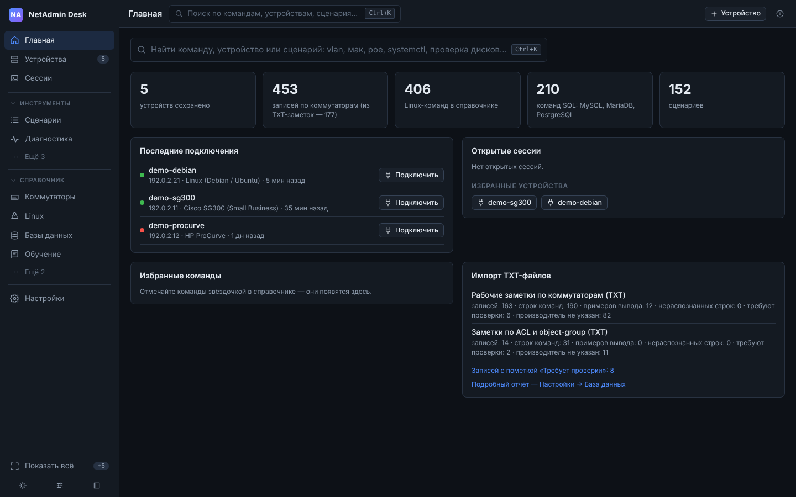 |  |
| 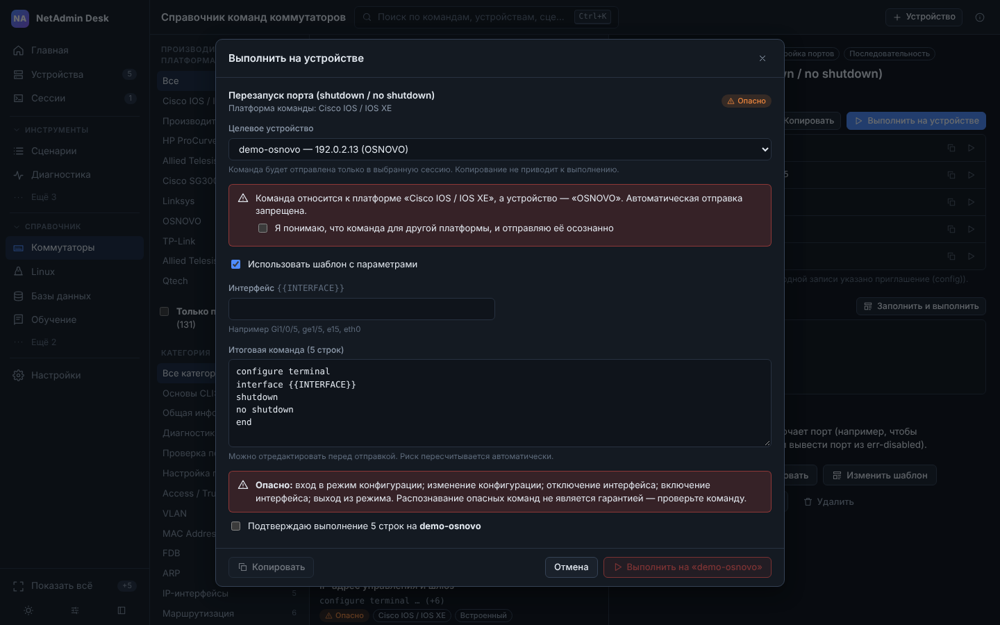 | 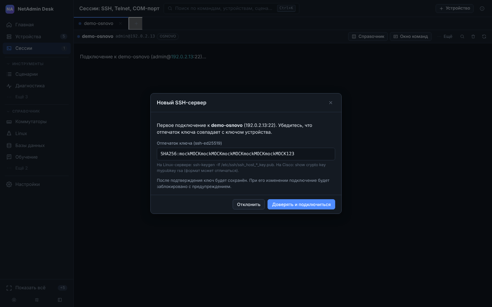 |
|  | 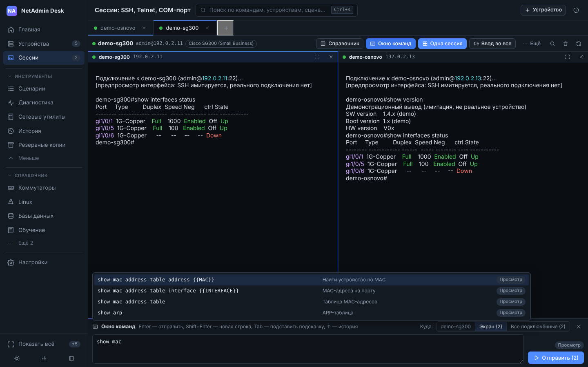 |
|  | 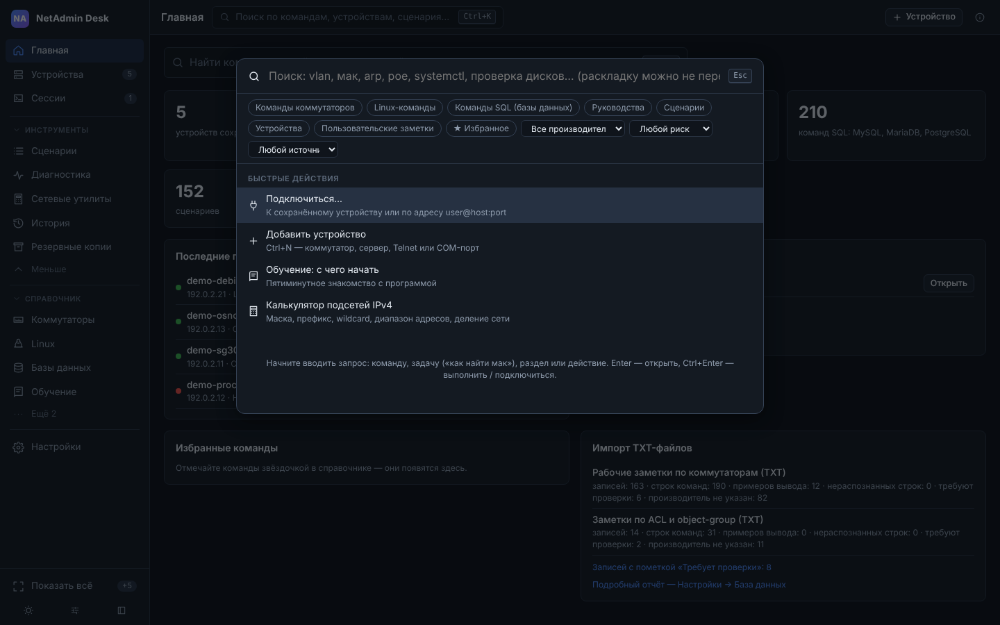 |
| 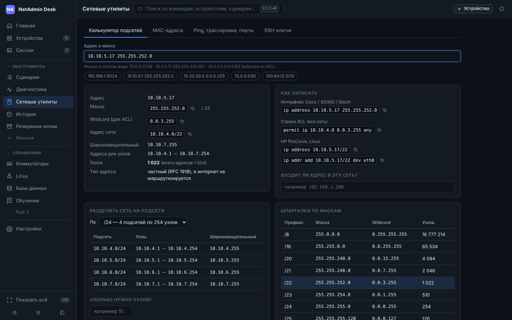 |  |
|  |  |
|  | 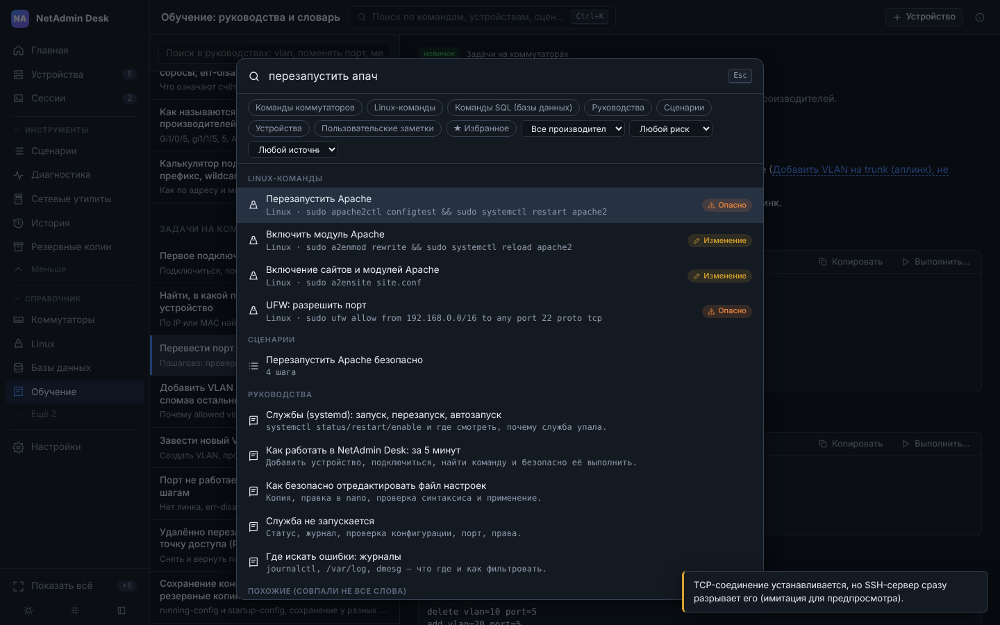 |
|  | 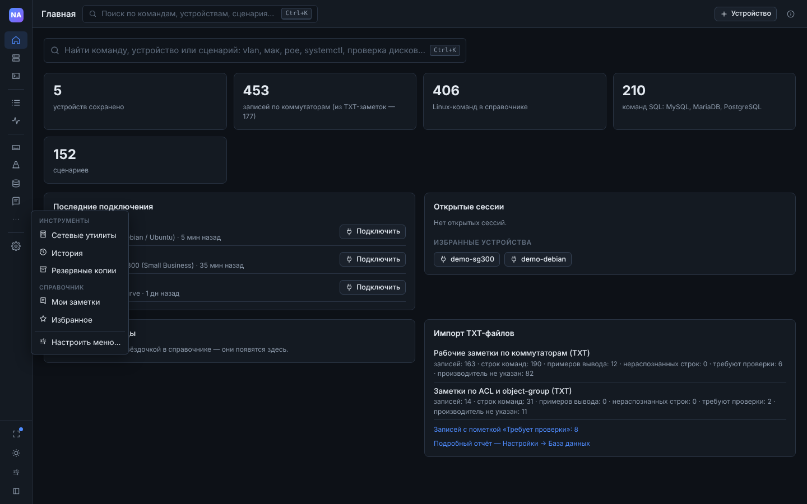 |
| 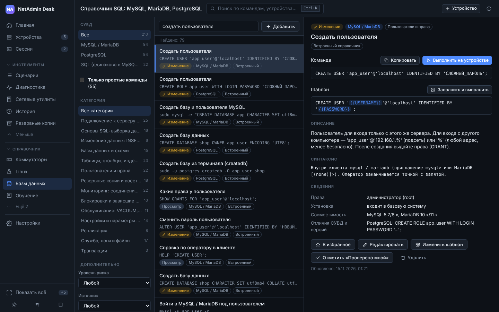 | 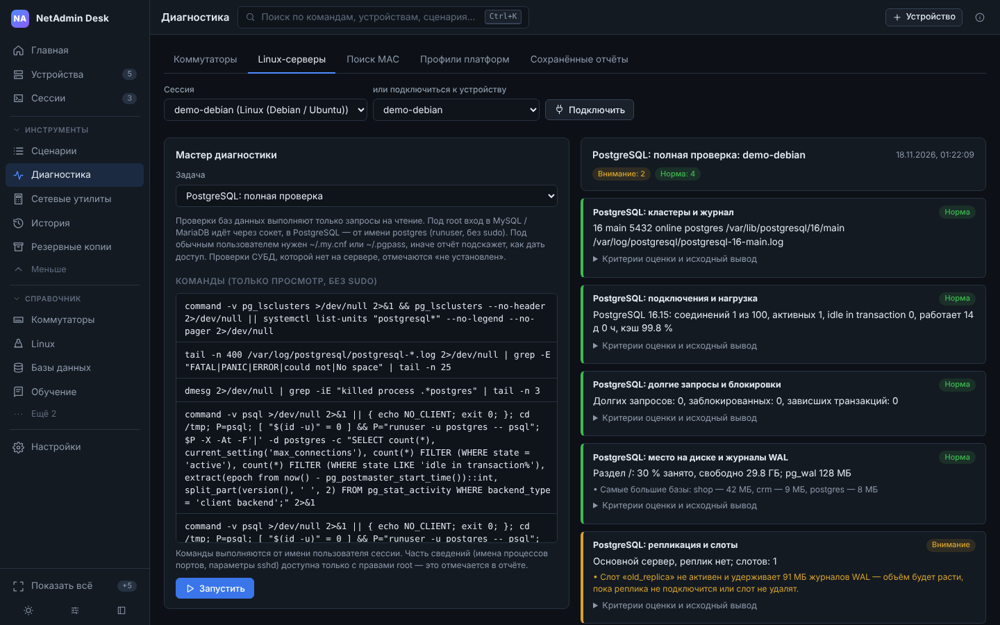 |
| 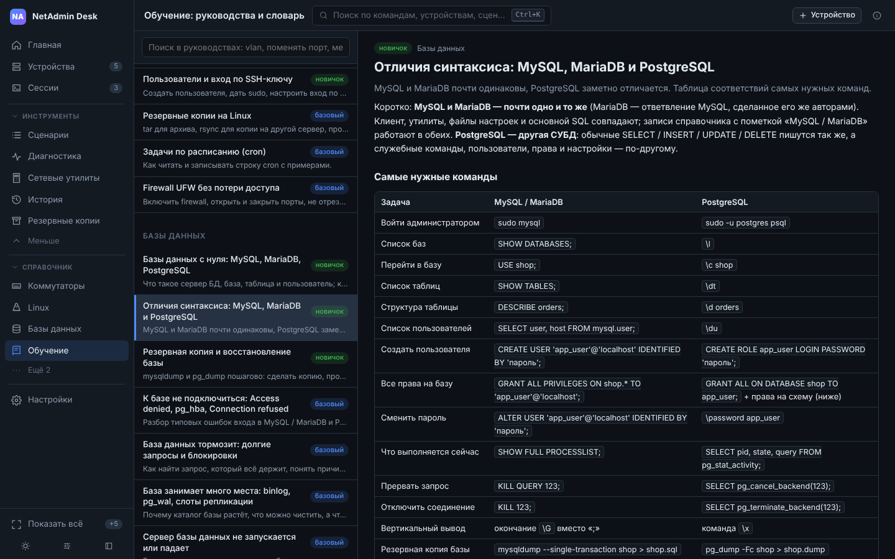 | 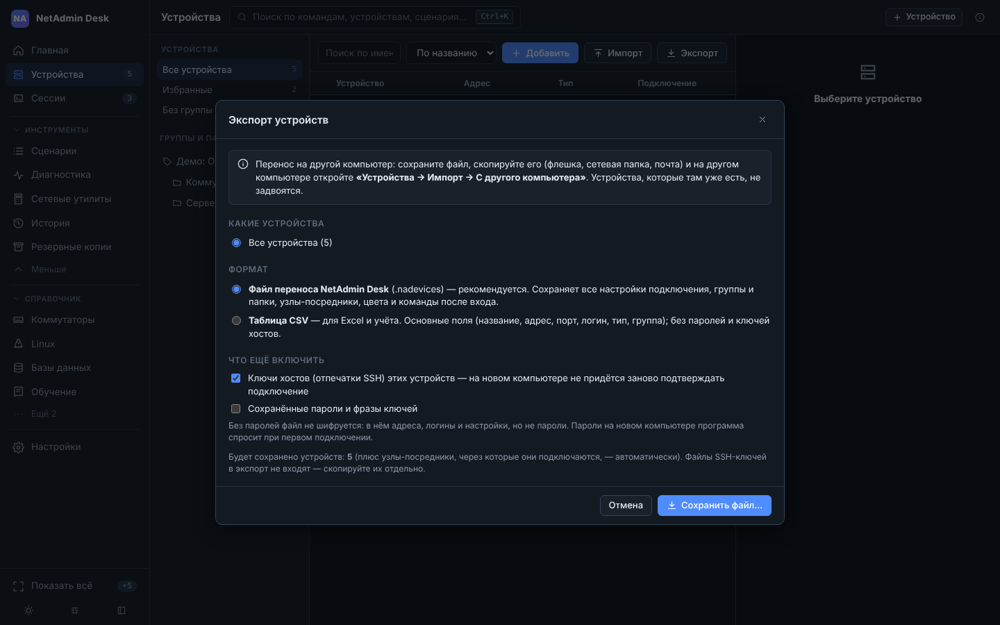 |
| 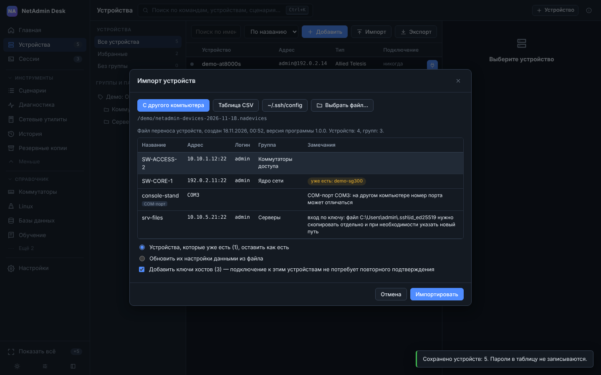 |  |